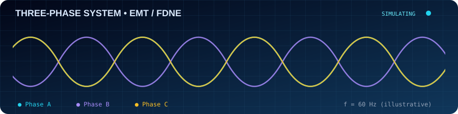

**[About](#-about-me) · [Research](#-research-lab) · [Projects](#-featured-work) · [Tech](#-engineering-toolkit) · [Publications](#-selected-publications) · [GitHub](#-github-activity) · [Connect](#-connect)**

## 

### Hi, I'm Sandeep! 👋

I'm a **PhD student in Electrical & Computer Engineering** at **Georgia Southern University**, exploring the intersection of **power engineering, electromagnetic transient simulation, and artificial intelligence**.

- 🔭 **Building:** ANN-based Frequency-Dependent Network Equivalents (FDNE)
- ⚡ **Exploring:** Power-system stability, state estimation & protection
- 🧠 **Interested in:** Physics-based modeling + machine learning
- 🛠️ **Working with:** Python, MATLAB, EMTP-RV, RSCAD/RTDS
- 😄 **Fun fact:** I think I'm funny!

 

## 🔬 Research Lab

| ⚙️ Research area | 💡 What I work on |
| :--- | :--- |
| **🔋 ANN-Based FDNE** | Learning voltage-to-current dynamics for EMT-level network equivalents |
| **⚡ State Estimation & Protection** | WLS, EKF, AC microgrids and intelligent protection |
| **🔌 Power Electronics** | EV charging converters and grid-forming inverter research |
| **📉 Nonlinear Stability** | Normal Form analysis of power-system dynamics |

## 🚀 Featured Work

<table>
<tr>
<td width="50%" valign="top">

### 🧠 Intelligent Network Equivalents
**FDNE × ANN × EMT**

Data-driven network identification for transient simulation, combining electrical modeling and neural networks.

  

</td>
<td width="50%" valign="top">

### ⚡ Intelligent Grid Protection
**State Estimation × Microgrids**

Static and dynamic state estimation for power-system monitoring and settingless protection.

  

</td>
</tr>
<tr>
<td width="50%" valign="top">

### 🔌 Power Conversion
**EV Charging × Inverters**

Research on a 50 kW solar-assisted EV charger and grid-forming inverter control.

 

</td>
<td width="50%" valign="top">

### 📈 Nonlinear Power Dynamics
**Stability × Normal Forms**

Analytical and numerical approaches to nonlinear stability of power-system models.

 

</td>
</tr>
</table>

## 🛠️ Engineering Toolkit

**Programming & AI**

**Simulation & Power Engineering**

**Data & Scientific Computing**

## 📚 Selected Publications

- 📄 **Advanced Settingless Protection Scheme for AC Microgrids Based on Dynamic State Estimations** — *Sādhanā* (2026). [Read paper](https://doi.org/10.1007/s12046-026-03233-2)
- 📝 **Design and Performance Validation of 50 kW DC–AC Power Converter for Fast EV Charging** — Accepted, *IEEE PEDES 2026* (publication pending)
- 📝 **Control and Performance Evaluation of 10 kVA Grid Forming Inverter under Variable RL Load** — Accepted, *IEEE PEDES 2026* (publication pending)

## 📊 GitHub Activity

### 🐍 Contribution Snake

<picture>
  <source media="(prefers-color-scheme: dark)" srcset="https://raw.githubusercontent.com/sandeeppandeyiitbhu/sandeeppandeyiitbhu/output/github-contribution-grid-snake-dark.svg">
  <source media="(prefers-color-scheme: light)" srcset="https://raw.githubusercontent.com/sandeeppandeyiitbhu/sandeeppandeyiitbhu/output/github-contribution-grid-snake.svg">
  
</picture>

## 🌐 Connect

### ⚡ Engineering Intelligent & Resilient Power Systems

